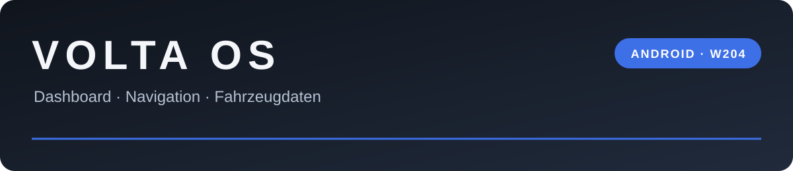

  

  Die Volta-Oberfläche auf deinem Android-Autoradio – mit Android-Apps und W204-Anbindung.

  
  

  
  

## Aufs Radio bringen

1. **[Aktuelle ARM64-APK herunterladen](https://github.com/whbkj2f5kj-lang/volta-android/releases/latest/download/volta-arm64.apk).** Aktuell wird ausschließlich die 64-Bit-Version gebaut.
2. Auf dem Radio installieren. Bei Updates die vorhandene App **nicht vorher deinstallieren**, damit Einstellungen und Keys erhalten bleiben. Der Signierschlüssel muss übereinstimmen.
3. Androids Installationsbestätigung abschließen und Volta öffnen.

Spätere Updates findest du direkt in **Settings → System → Software update**: **Check for updates** prüft und lädt eine neue Version, **Install update** öffnet danach die Android-Installation. Volta prüft auch automatisch im Hintergrund.

**[Versionshinweise und Downloads →](https://github.com/whbkj2f5kj-lang/volta-android/releases/latest)**

## Was Volta mitbringt

| Bereich | Android-Anbindung |
| :--- | :--- |
| **Oberfläche** | Voltas Dashboard mit 3D-Fahrzeug, App-Ansicht und vorhandenen Benachrichtigungskarten |
| **Apps** | Installierte Android-Apps starten und Volta-Symbolen zuordnen; Web-Ansichten über Android System WebView |
| **Navigation** | Android-GPS, Karten, Ortssuche und Tempolimits; einzelne Dienste benötigen eigene API-Keys |
| **OBD** | Standard-Motordaten über Bluetooth-ELM327 und lesende Mercedes-Diagnose; herstellerspezifische Messwerte sind noch fahrzeugspezifisch zu bestätigen |
| **Radio / CAN** | Fahrzeugdaten des unterstützten Radio-Dienstes, etwa Türen und Blinker; verfügbare Daten hängen von Firmware und CAN-Box ab |
| **Kamera** | Kameravorschau, optionale USB-Dashcam und Schildererkennung |
| **Reifendruck** | Optionale USB-TPMS-Anbindung mit Sollwerten und visuellen Hinweisen |

Der Port wird weiterentwickelt. Hardwarefunktionen werden zusätzlich am jeweiligen Radio geprüft; ein erfolgreicher Build ersetzt diesen Test nicht.

## Keys ohne Abtippen

Unter **Settings → Vehicle → Keys (keys.env)** kannst du eine vorbereitete Datei aus Downloads oder von einem USB-Stick auswählen.

Unterstützte Anbieter-Einträge sind `MAPBOX_TOKEN`, `MAPTILER_KEY`, `TOMTOM_KEY` und `OWM_KEY`. Der optionale GitHub-Key für den Log-Upload lässt sich ebenfalls darüber übernehmen. Echte Keys gehören in deine lokale Datei, nicht ins öffentliche Repository.

**[Details zur Android-Anbindung →](volta-android/README.md)**

## Dein W204 in Schwarz

Das vorbereitete 3D-Modell liegt als separater Download im Repository. Import und Quellenangabe stehen beim Modell.

**[W204-Modell herunterladen](models/w204-black.zip)** · **[Import und Urheberhinweis](models/README.md)**

## Diagnose und Entwicklung

- **[Builds und Prüfungen](https://github.com/whbkj2f5kj-lang/volta-android/actions/workflows/volta.yml)** – Fortschritt und Ergebnisse der GitHub-Builds.
- **[Android-Port](volta-android/README.md)** – Einrichtung, technische Anbindung und Tests.
- **[Mercedes-Diagnose OM651 / 5G-Tronic](docs/obd-om651-5g.md)** – Quellen, Kandidaten und Grenzen der Messwerte.
- **Logs auf dem Radio:** `Android/data/de.jarvis.volta/files/`, insbesondere `volta_log.txt`, `volta_obd_log.txt`, `volta_keys.txt` und `volta_can_log.txt`.

| Pfad | Inhalt |
| :--- | :--- |
| `volta-android/` | Android-Port, Qt-Anbindung und QML-Anpassungen |
| `core/` | Fahrzeug-, OBD-, Kamera- und weitere technische Komponenten |
| `models/` | W204-Modell und Quellenangaben |
| `.github/workflows/volta.yml` | APK-Build, Tests und Release-Veröffentlichung |

## Basis und Lizenz

Dieser Android-Port basiert auf **[VoltaOS von Omardigio](https://github.com/Omardigio/VoltaOS)**. Der Build verwendet einen festgelegten Upstream-Stand und ergänzt die Android-Anbindung; die Volta-Oberfläche bleibt die gestalterische Basis.

**[GPL-3.0](LICENSE)** · Kartenbibliothek: **[MapLibre Native Qt](https://github.com/maplibre/maplibre-native-qt)** unter BSD-2-Clause. Die Quellenangabe für das Fahrzeugmodell steht in [models/README.md](models/README.md).
